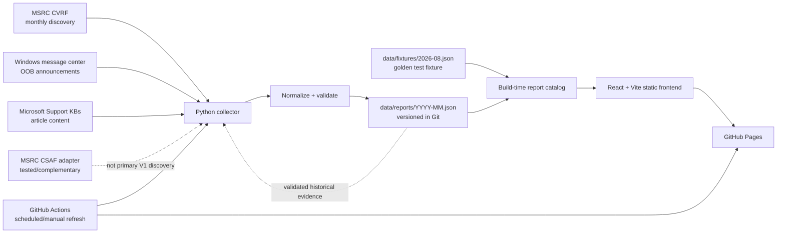

# Windows Patch Dashboard

`PROJECT.md` is the primary 80/20 context for the current repository. It describes what the project is and how the verified implementation works. For rationale, read `DECISIONS.md`; for agent behavior, read `AGENTS.md`; for commands and operations, read `RUNBOOK.md`.

## Purpose

Windows Patch Dashboard turns official Microsoft Patch Tuesday information into a compact monthly report for infrastructure, security, DevOps, sysadmin, patch-management, vulnerability-management, and IT operations users.

It provides:

- Windows Server 2012/2012 R2 ESU and newer Windows Server coverage defined by the data contract;
- supported Windows 11 branches represented for a report month;
- KB, OS, key changes, resolved issues, and known issues in five canonical report columns;
- official-source provenance for generated production records;
- interactive filtering, Report Mode, Client Report for browser print/Save as PDF, and client-side PNG export.

It does **not** provide device inventory, patch compliance, authentication/accounts, a vulnerability-management backend, a database-backed API, or runtime AI analysis.

## Current Architecture

The browser does not call Microsoft. Collection happens in Python locally or in GitHub Actions. The frontend consumes validated JSON bundled at build time.

## Data Flow

1. A strict `YYYY-MM` report month is selected. Automatic selection enables the current month at its second Tuesday's 14:15 ART (UTC-3) window; before then it selects the preceding month. Manual dispatch preserves an explicit month override.
2. The collector retrieves the monthly MSRC CVRF document for monthly KBs and the official Windows message center for dated OOB announcement links. After ESU end, bounded official product-history navigation can discover dated exceptional OOB links missing from those sources. It maps supported product/OS labels to normalized identities and excludes hotpatch-only packages through their official Support path. Generic ESU security candidates are retained for Monthly Rollup verification; verified Support titles exclude SSU, security-only, and auxiliary packages from principal monthly rows.
3. Each discovered KB requiring live verification is checked against official Microsoft Support in an independent HTTP session. `es-ES` content is preferred; `en-US` is the fallback when Spanish content cannot be retrieved and parsed reliably. Validated prior production reports can supply known canonical URLs and narrowly scoped evidence to exclude exact undated historical candidates before fetching Support. Earlier-month evidence never populates current rows or claims a new retrieval. Independently verified same-month fields can be retained after temporary article failures with their original provenance.
4. Microsoft Support provides deterministic article content for changes, fixes, and known issues. Hotpatch exclusions require an official Support redirect under Microsoft's `/hotpatch/` path.
5. Normalization applies product rules, canonical ordering, provenance, known-issue semantics, separate publication/verification/lifecycle states, ordinary ESU-end annotations from November 2026, and fail-safe conflict checks. Explicit OOB labels from CVRF, message center announcements, or the verified Microsoft Support article title add a separate record; supersedence is linked only when CVRF states it.
6. The report is schema/semantics validated and atomically written to `data/reports/YYYY-MM.json`. An existing report is preserved if collection or validation fails.
7. A lightweight schedule gate enables the approved ART slots before collection. Scheduled/manual automation validates the report and waits for D 10:00 Pacific. Contract 1.1 requires official KB evidence (including explicit pending/partial rows); legacy 1.0 requires Support-verified monthly evidence. Comparison ignores `generatedAt`, source `retrievedAt` and `verification.checkedAt`, coalescing source captures that differ only by timestamps. Only substantive changes are committed.
8. Vite imports `data/fixtures/*.json` and `data/reports/*.json` at build time. A production report overrides a same-month fixture.
9. GitHub Pages serves the resulting static React application.

## Repository Structure

| Path | Responsibility |
| --- | --- |
| `collector/` | Python package, Microsoft source adapters, normalization, validation, automation helpers, and pytest tests. |
| `frontend/` | React/Vite/TypeScript UI, local report loader, filtering, Report Mode, PNG export, and Vitest tests. |
| `data/schema/` | JSON Schema contract for monthly reports. |
| `data/reports/` | Generated/versioned production report JSON. |
| `data/fixtures/` | Test fixtures; `2026-08.json` is the manual golden fixture. |
| `.github/workflows/` | CI plus report refresh and GitHub Pages deployment. |
| `docs/` | Historical/phase-specific design and source-evaluation documentation. |
| `design/` | Visual design reference and Phase 2 design notes. |
| `third_party/` | Third-party license material. |

## Technology Stack

- Python package requirement: `>=3.11`; GitHub Actions and the current README use Python 3.12.
- `httpx`, BeautifulSoup, `lxml`, `jsonschema`.
- pytest, Ruff, mypy.
- React 19, TypeScript 5.9, Vite 7.
- Vitest, Testing Library, ESLint, Prettier.
- `html-to-image` for browser-side PNG export.
- GitHub Actions for CI, refresh, and deployment orchestration.
- GitHub Pages for static hosting.

## Current Features

- Monthly report catalog derived from bundled fixture/report JSON.
- Newest available month selected by default; users can switch among bundled months.
- Individual OS selection with canonical report ordering.
- Five canonical report columns.
- Contract 1.1 distinguishes publication (`verified`, `partial`, `pending`, `not-published`), known issues and lifecycle. Historical 1.0 reports retain their original meaning.
- Both Server 2012 ESU programmes ended on 13 October 2026. Later absence rows display `SIN ACTUALIZACIÓN — ESU FINALIZADO`, with official sources and a migration recommendation. Exceptional verified updates remain eligible.
- OOB supersedence displayed independently from known-issue state.
- Official source links in Interactive Mode.
- Light/dark theme with system preference and persisted explicit choice.
- Report Mode optimized for a dense shareable artifact.
- High-resolution client-side PNG export of the filtered report.
- Neutral Client Report with an executive summary per KB, followed by full OS/KB sections, official links, and selectable text in browser-generated PDFs.
- Adaptive Patch Tuesday/manual report refresh and semantic change detection.

## Current State

Implementation: November 2026, including incremental publication and contract 1.1.

- `main` is the default branch.
- Production reports cover August through November 2026. November uses the reviewed 1.1 migration; earlier reports retain their 1.0 content and status.
- `data/fixtures/2026-08.json` is the manual golden fixture; the production report takes precedence for the same month.
- The reviewed November 1.1 report has 9 records: 7 complete monthly KBs and 2 verified exceptional ESU OOBs dated 6 November, with lifecycle metadata and status `generated`. Historical reports retain their 1.0 content and status.
- `.github/workflows/pages.yml` handles pushes to `main`, the adaptive ART schedule and manual dispatch. D has nine hourly slots; D+1 seven; D+2 four; D+3 two; otherwise one daily slot. GitHub delays are tolerated for six hours, with no replay of omitted slots.
- The public project URL encoded in the frontend is `https://f4cus.github.io/windows-patch-dashboard/`.

## Known Limitations / Technical Debt

- V1 monthly discovery depends on CVRF; there is no automatic bulk-CSAF fallback.
- CSAF parsing exists and is tested, but it is complementary and is not used by the production monthly collection path.
- Microsoft Support extraction depends on recognizable article structure. Unverifiable known-issue evidence remains `unknown` rather than being guessed.
- Support routes, including canonical URLs, can return HTTP 403. Prior validated production reports help locate official URLs and identify exact historical KB/OS pairs; they cannot replace required live verification for current candidates. Unresolved current candidates remain pending while verified KBs publish. Unsafe global failures preserve the last valid report.
- OOB discovery requires an explicit official label from CVRF, the Windows message center, a verified Support article title, or dated post-ESU product-history navigation. Missing supersedence evidence leaves the link null. Discovery is bounded and can miss old announcements; confirmed same-month OOB records are retained with original provenance when later discovery fails.
- The month selector includes August through November 2026; the November report uses explicit lifecycle metadata.
- The report contract is validated both in Python and again by the TypeScript loader. This is useful defense in depth but creates contract-sync maintenance work.
- Contract 1.1 records row publication status, dated Support verification and retained evidence. Individual article failures are isolated; verified contradictions still fail before atomic output.
- CVRF vulnerability entries discover and deduplicate KB/product relationships, but the monthly contract does not retain CVE identifiers or severity. A future phase must decide whether to rename the column to "Cambios destacados" or extend the contract with verifiable CVE data.
- Historical docs contain some Phase-specific statements that no longer match the current UI/source behavior; use the root harness files and current code/workflows as the operational context.

## Sources of Truth

| Concern | Source of truth |
| --- | --- |
| Monthly data contract | `data/schema/monthly-report.schema.json` plus semantic checks in `collector/src/windows_patch_collector/validation.py` |
| Production data | `data/reports/*.json` |
| Golden test data | `data/fixtures/2026-08.json` |
| Product aliases/order | `collector/src/windows_patch_collector/products.py`, `ordering.py` |
| Microsoft collection | `collector/src/windows_patch_collector/` and `sources/` |
| Atomic output / semantic refresh | `collector/src/windows_patch_collector/output.py`, `automation.py` |
| Frontend data model/loading | `frontend/src/data/model.ts`, `loadMonthlyReport.ts`, `reportCatalog.ts` |
| UI behavior | `frontend/src/` and its tests |
| CI | `.github/workflows/ci.yml` |
| Refresh / Pages deployment | `.github/workflows/pages.yml`, `frontend/vite.config.js` |
| Active technical decisions | `DECISIONS.md` |
| Historical Phase rationale | `docs/decisions.md`, `docs/phase-3-*.md` |

## Incremental Refresh

Publish confirmed KB/product facts without waiting for all Support content. Missing fields
remain unavailable and the row/report partial; insufficient classification remains pending.
Refreshes preserve previously confirmed same-month fields and OOB records with original
provenance, then publish substantive enrichment. CVRF failure, invalid output and verified
unresolvable conflicts stop replacement. Generation, source retrieval and verification check
timestamps alone do not produce commits. See D012 and the runbook for the exact boundaries.

The November lifecycle-source review found actual exceptional OOB publications after ESU end.
Those verified KBs are included instead of absence placeholders; the absence label is used
only when no later update/candidate is documented. Product-history discovery is bounded to
the reviewed ESU product pages and explicit dated OOB navigation links; article content and
applicability remain independently checked when accessible.
